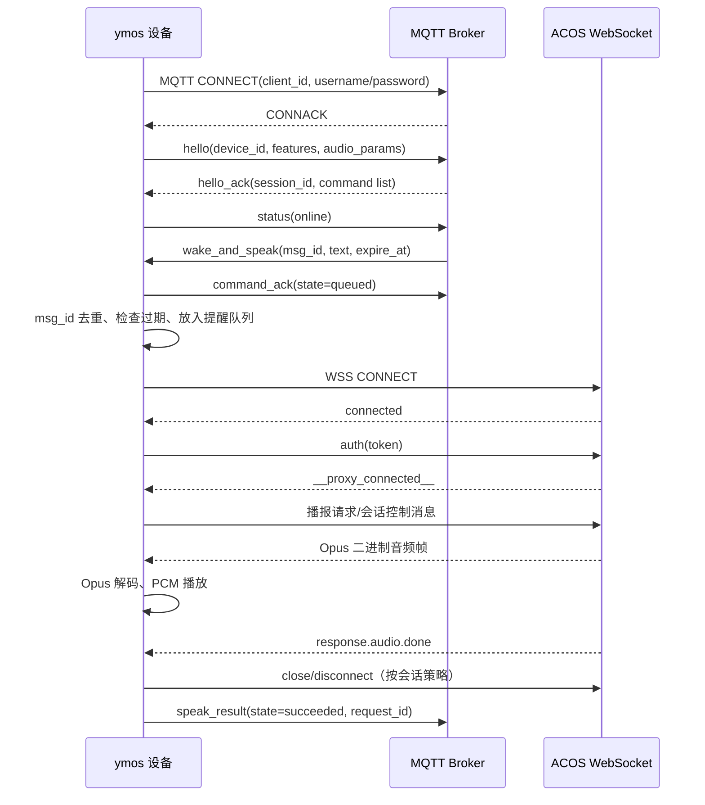
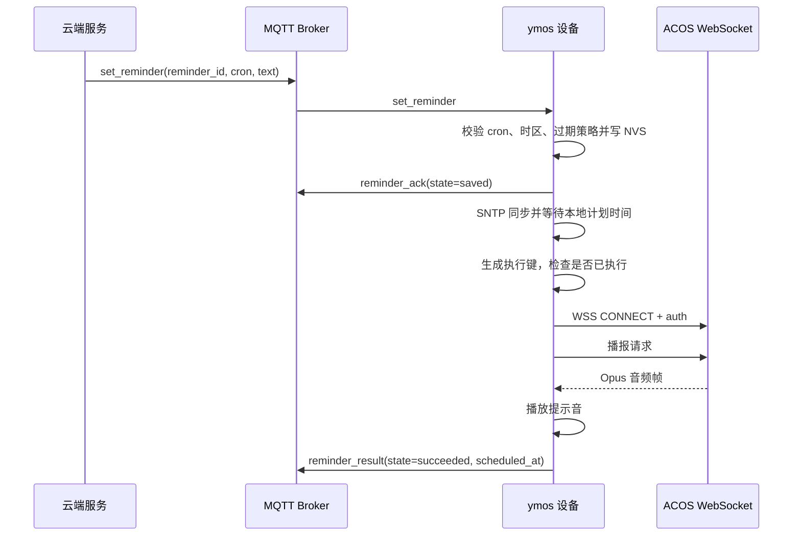
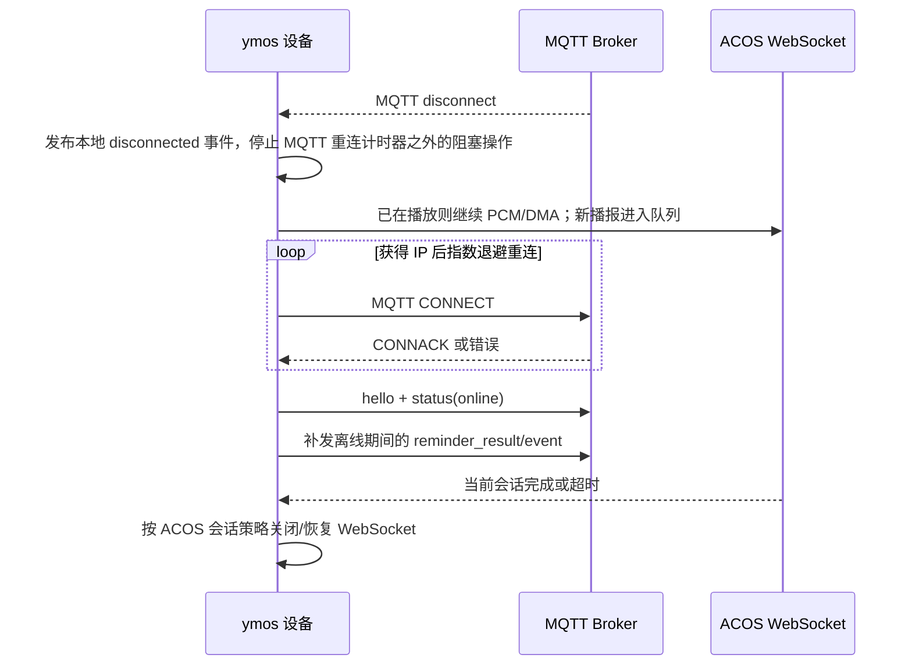

# ymos-esp32 功能完善计划

## 1. 目标与范围

`ymos-esp32` 增加三类能力（配置、网络和协议分层）：

1. **NVS 配置体系完善**：统一保存设备身份、Wi-Fi、ACOS WebSocket、MQTT 和运行参数，支持版本迁移、恢复默认值和掉电安全。
2. **Wi-Fi 配网**：设备无有效凭据时进入配网模式，用户通过手机完成 Wi-Fi 配置；配置保存后自动切换 STA，并支持超时、重试和重新配网。
3. **MQTT 通信**：增加独立 MQTT 客户端，用于设备状态、配置下发、控制命令和 OTA/升级通知；ACOS 音频 WebSocket 继续作为实时音频通道。

本计划不把 MQTT 直接改造成音频传输通道，也不默认替换现有 ACOS WebSocket。这样可以保留当前音频链路的时序和低延迟特性。

## 2. 当前基线与主要差距

### 2.1 已有能力

- `main/cfg_service.c` 已使用 NVS namespace `korvo_cfg`，支持字符串、整数、布尔值。
- 已保存 Wi-Fi SSID/密码、ACOS token、WebSocket URL、设备 ID、房间 ID、模型和部分运行参数。
- `main/wifi_service.c` 已实现 STA 初始化、自动重连、IP 获取、RSSI 和事件发布。
- `main/ws_service.c` 已实现 ACOS WSS、鉴权、Opus 上行和二进制 Opus 下行。
- `main/app_main.c` 已有统一事件总线和应用状态机，可作为配网、MQTT 状态接入点。

### 2.2 待补齐问题

- 当前没有用户可操作的配网入口；没有 AP+HTTP、BluFi 或其他配网会话管理。
- 配置键没有 schema 版本、字段校验、敏感字段保护和迁移机制。
- Wi-Fi 启动流程主要依赖编译期默认值，缺少“无凭据/凭据失效”的明确状态和配网回退。
- 没有 MQTT 服务、主题约定、鉴权、TLS、遗嘱、重连退避和离线消息策略。
- MQTT、WebSocket、配网对 Wi-Fi 生命周期的所有权尚未定义，容易出现重复初始化、竞态和状态覆盖。
- 缺少针对 NVS 掉电、配网超时、网络抖动、MQTT 重连和协议兼容性的自动化测试。

## 3. 总体架构

建议沿用现有 C/ESP-IDF 结构，新增服务而不是把逻辑堆到 `app_main.c`：

```text
app_main / event_bus
        |
  app_state（INIT / PROVISIONING / WIFI / MQTT / WS / AUDIO）
        |
  cfg_service  <----> NVS（schema/version/checksum）
        |
  provisioning_service ---- Wi-Fi AP/HTTP 或 BluFi
        |
  wifi_service ---- shared STA lifecycle ---- mqtt_service
                                      \------ ws_service（ACOS 音频）
```

原则：

- 只有 `wifi_service` 负责 STA 生命周期；MQTT 和 WebSocket 只订阅网络状态。
- 只有 `cfg_service` 负责配置持久化，其他服务读取快照，不直接操作 NVS。
- 配网期间暂停 MQTT 和 ACOS WebSocket；拿到有效 IP 后按顺序启动 MQTT，再按唤醒策略启动 WebSocket。
- 所有网络回调只投递事件，不在回调线程中执行阻塞重连、NVS 写入或音频操作。

## 4. 阶段计划

### 阶段 0：基线整理与接口冻结

**目标**：在改功能前固定现有行为和公共接口。

- 记录当前 `cfg_service`、`wifi_service`、`ws_service`、`app_state` 的调用关系和事件编号。
- 为 `app_event_t` 增加网络服务事件命名约定，避免 MQTT 与 Wi-Fi 事件混用。
- 定义 `ymos_config_t` 配置快照结构，服务启动时一次读取，运行期通过受控 API 更新。
- 补充编译选项和依赖清单：`mqtt`/`esp-mqtt`、`esp_http_server`、`esp_netif`、`cJSON`（如采用 JSON 配置接口）。

**验收**：现有 ACOS WebSocket 音频功能行为不变；`idf.py build` 通过；事件和配置接口有头文件说明。

### 阶段 1：NVS 配置体系完善

**目标**：把当前零散键值升级为可迁移、可校验的配置模块。

建议配置分组：

| 分组 | 字段 |
|---|---|
| device | `device_id`、`product_id`、`firmware_version`、`config_version` |
| wifi | `ssid`、`password`、`dhcp/static_ip/gateway/dns` |
| acos | `ws_url`、`token`、`room_id`、`model` |
| mqtt | `enabled`、`host`、`port`、`username`、`password`、`client_id`、`base_topic`、`tls` |
| runtime | `vad_enable`、`barge_in_enable`、`led_mode`、`volume`、`log_level` |
| provisioning | `paired`、`provisioning_timeout`、`last_error` |

实施项：

- 增加 `CFG_SCHEMA_VERSION` 和启动迁移函数，至少支持当前版本到下一版本的字段迁移。
- 所有字符串读取采用长度检查和默认值；URL、端口、token、主题前缀做格式校验。
- 敏感字段不打印明文日志；提供 `cfg_service_get_snapshot()` 和按字段更新 API。
- 写入使用“校验 -> 写入临时键/版本 -> commit -> 更新 active 标记”的顺序，避免掉电留下半套配置。
- 增加恢复默认配置 API，区分“仅清网络配置”和“全量恢复出厂”。
- 评估独立 NVS namespace：`ymos_cfg`、`ymos_secret`；若使用 NVS encryption，需在文档中明确密钥/生产烧录流程。

**验收**：首次启动、升级迁移、掉电模拟、非法值、恢复默认均有测试；旧设备已有 Wi-Fi/ACOS 配置可继续启动。

### 阶段 2：Wi-Fi 配网

**目标**：没有有效凭据或用户主动重置时，设备可被手机配置并可靠回到 STA。

建议优先实现 **SoftAP + HTTP 配网**，后续再增加 BluFi 适配。原因是可以复用 ESP-IDF `esp_http_server`，跨平台调试简单，且不把配网绑定到特定手机 App。

流程：

1. 启动读取配置；若 SSID 为空、连续连接失败达到阈值或按键触发，进入 `APP_STATE_PROVISIONING`。
2. 启动 SoftAP，SSID 使用设备名后缀和 MAC，设置随机或固定的配网密码策略。
3. 提供最小 HTTP API：`GET /api/info`、`GET /api/scan`、`POST /api/wifi`、`POST /api/reset`、`GET /api/status`。
4. `POST /api/wifi` 只做参数校验和 NVS 原子写入；随后停止 AP，启动 STA 连接。
5. STA 在限定时间内获得 IP 才将 `paired=true`；失败则回到配网页面并保留旧凭据，避免错误配置覆盖可用配置。
6. 配网成功后发布 `EV_WIFI_GOT_IP`、`EV_PROVISIONING_DONE`，启动 MQTT；ACOS WebSocket 仍按唤醒词策略延迟连接。

安全和体验要求：

- 配网页面不显示已保存密码；HTTP 请求限制长度、频率和并发数。
- AP 无客户端一段时间后自动关闭；提供按键长按重新进入配网。
- 配网和 STA 的 LED 状态明确区分；串口日志不打印密码/token。
- 明确手机连 AP 后无互联网属于预期状态，避免误判为设备故障。

**验收**：空配置、错误密码、路由器不可见、重复提交、断电恢复、主动重配、配网超时和 AP 自动退出均可复现并有记录。

### 阶段 3：MQTT 服务

**目标**：建立可独立启停、可重连、可观测的 MQTT 控制面。

建议新增：`main/mqtt_service.h/.c`、`main/mqtt_topics.h`、`main/mqtt_codec.h/.c`。

连接能力：

- MQTT 3.1.1 起步，TLS（MQTTS）为生产默认；开发环境允许明文但必须显式配置。
- 支持 host、port、client_id、username/password 或 token、keepalive、SNI/CA 证书配置。
- 使用设备 ID 生成默认 client_id；设置 LWT：`{base}/device/{id}/status = offline`。
- 连接成功发布 retained `online`，并订阅命令和配置主题。
- 断线采用指数退避和抖动，限制最小/最大重连间隔；网络未获 IP 时不启动重连计时器。

建议主题：

| 方向 | 主题 | 内容 |
|---|---|---|
| 上行 | `{base}/device/{id}/status` | online/offline、RSSI、IP、固件版本、服务状态 |
| 上行 | `{base}/device/{id}/event` | 配网、错误、唤醒、WebSocket/MQTT 状态事件 |
| 上行 | `{base}/device/{id}/metrics` | 音频包、延迟、重连次数、内存和任务水位 |
| 下行 | `{base}/device/{id}/command` | 重启、进入配网、恢复默认、测试提示音 |
| 下行 | `{base}/device/{id}/config/set` | 部分配置更新 |
| 上行 | `{base}/device/{id}/config/ack` | 配置更新结果和错误码 |
| 下行 | `{base}/device/{id}/ota` | OTA 任务描述和校验信息 |

消息约定：

- JSON 必须包含 `msg_id`、`timestamp`、`type`、`version`；服务端未知字段设备忽略。
- 命令处理具备幂等性，按 `msg_id` 去重并返回 ACK。
- 配置下发先校验、再写 NVS，必要时重启对应服务；Wi-Fi/MQTT 凭据变更使用两阶段切换。
- 默认不通过 MQTT 传输实时音频；如未来需要 MQTT 音频，另立协议和带宽评估。

本阶段的具体协议以本文第 8、9 节为准：第 8 节定义设备身份、client_id、启动顺序、主题生成和故障恢复；第 9 节定义 `hello/hello_ack`、`status`、`wake_and_speak`、`command_ack`、`speak_result`、`set_reminder` 以及 MQTT 到 ACOS WebSocket 的交互时序。实现时不再另行创建一套主题或字段命名。

实现约束补充如下：

- 状态和结果主题使用 QoS 1；`status=online` 和 `status=offline` 使用 retained。实时指标默认 QoS 0、不 retained。
- `command`、`config/set`、`ota` 使用 QoS 1；设备处理完成后必须发布 ACK，ACK 至少包含原始 `msg_id`、`accepted`、`state` 和错误码。
- 设备端维护有限长度的 `msg_id` 去重缓存；重复消息返回同一 ACK，不得重复执行重启、配网、播报或配置写入。
- 主题中的 `{id}` 使用持久化 `device_id`，不能在每次启动时重新生成；`client_id` 冲突、TLS 失败、鉴权失败和网络未就绪必须分别记录错误原因。
- MQTT 回调只负责校验、去重和投递事件；连接 ACOS、播放提示音、写 NVS 和重启等动作由主任务按状态机执行。
- `config/set` 采用“完整校验 -> 临时保存 -> commit -> 重启对应服务 -> 发布 ACK”的顺序；Wi-Fi/MQTT 凭据切换失败时保留上一份可用配置。
- OTA 主题在本阶段只接收和校验任务描述；实际下载、签名校验和切换应复用独立 OTA 流程，不在 MQTT 回调中执行。

**验收**：TLS 连接、错误凭据、LWT、断网重连、重复命令、非法 JSON、配置 ACK、设备重启后 retained 状态均通过测试。

### 阶段 4：状态机和服务联动

**目标**：让配网、Wi-Fi、MQTT、ACOS WebSocket 在异常情况下可预测。

- 增加状态：`PROVISIONING`、`MQTT_CONNECTING`、`MQTT_CONNECTED`、`NETWORK_DEGRADED`（或使用独立子状态）。
- Wi-Fi 掉线时：停止 MQTT 发布/订阅和 ACOS WebSocket，清理待发送控制消息；恢复 IP 后先 MQTT 后 WebSocket。
- MQTT 断线不影响已建立的 ACOS 音频会话恢复策略，但不得阻塞音频任务。
- 配网、MQTT 命令和本地按键都通过同一事件总线触发重启/恢复默认/重连。
- 为每个服务增加 generation 或 session id，丢弃旧连接回调，避免断线重连后的竞态。
- LED 显示优先级明确：配网 > Wi-Fi 错误 > MQTT 错误 > WebSocket/音频状态。

**验收**：反复插拔路由器、MQTT broker、ACOS 服务和设备电源，系统不死锁、不重复创建任务、不发送旧会话数据。

### 阶段 5：安全、运维和测试

- 生产构建启用 NVS encryption、TLS CA 校验和安全启动/Flash 加密评估。
- 删除所有默认真实凭据；日志统一脱敏 token、密码和 MQTT 密钥。
- 增加命令行/串口诊断：显示配置摘要（脱敏）、Wi-Fi/MQTT/WS 状态、任务堆栈和重连原因。
- 单元测试覆盖配置迁移、主题生成、JSON 编解码、命令幂等和退避算法。
- 集成测试覆盖真实 AP、MQTT broker、ACOS mock server；记录内存、CPU、启动时间和断网恢复时间。
- 建立故障码表和版本兼容策略，协议版本变更保持向后兼容。

## 5. 建议的代码交付顺序

1. 配置快照和 schema 迁移，不改变现有业务行为。
2. Wi-Fi 连接错误分类和配网状态机。
3. SoftAP + HTTP 配网最小闭环。
4. MQTT 连接、LWT、状态上报和命令 ACK。
5. 配置下发与服务重启联动。
6. TLS/NVS encryption、OTA 通知、BluFi 和更完整的诊断能力。

每一步都保持可编译、可刷写、可回退；不要在同一个提交中同时改变 ACOS 音频协议和 MQTT 控制协议。

## 6. 风险与决策点

| 风险/决策 | 建议 |
|---|---|
| 配网方式 | 先 SoftAP + HTTP，BluFi 作为后续适配；若已有配套 App，再增加 BluFi |
| MQTT broker 协议 | 先 MQTT 3.1.1；确认服务端后再决定 MQTT 5 特性 |
| MQTT 与 ACOS 的关系 | MQTT 负责控制面和运维，ACOS WSS 负责实时音频 |
| 凭据保护 | 开发阶段 NVS 普通存储，生产阶段启用 NVS encryption 和 TLS CA 校验 |
| 配置变更生效 | 普通参数热更新；Wi-Fi/MQTT endpoint/token 采用停服务、写入、重连的事务流程 |
| IDF 版本 | 当前 ymos 基于 IDF 5.4.4；先在此版本完成，再单独评估迁移到 IDF 6 |

## 7. 完成标准

功能完成的最低标准是：

- 新设备无需重新烧录固件即可通过配网连接 Wi-Fi。
- Wi-Fi、ACOS、MQTT 配置重启后保持，升级后可迁移，错误配置可恢复。
- MQTT 能可靠上报在线状态、设备状态和诊断事件，并接收幂等控制命令。
- Wi-Fi/MQTT/ACOS 任一服务断线不会阻塞音频采集、播放和主状态机。
- 关键敏感信息不出现在日志和未加密 MQTT 连接中。
- 具备自动化测试、故障注入记录和可重复的刷机验证流程。

## 8. MQTT 服务细化设计

### 8.1 设备 ID、序列号与默认 client_id

设备身份分为三个字段，避免把 MQTT 连接标识和业务设备编号混为一谈：

| 字段 | 来源 | 是否允许修改 | 用途 |
|---|---|---:|---|
| `chip_id` | ESP32 eFuse MAC（`esp_efuse_mac_get_default` 或 `esp_read_mac`） | 否 | 芯片硬件唯一身份，永不写入用户配置 |
| `device_id` | 首次启动由 `chip_id` 派生并写入 NVS；生产烧录时也可预置 | 受控修改 | 平台业务设备编号、主题路径和日志关联 |
| `client_id` | NVS 中的显式值；为空时由 `device_id` 派生 | 可修改 | MQTT CONNECT 的客户端标识 |

推荐规则：

```text
chip_id   = 大写十六进制 MAC，无冒号，例如 A1B2C3D4E5F6
device_id = "ymos-" + chip_id
client_id = "ymos-" + device_id + "-" + 固件短版本
```

实际生成时应限制在 MQTT broker 的 client-id 长度范围内；若服务端要求固定格式，则使用 `ymos-` 加 MAC 后 12 位作为稳定默认值。不要使用随机 UUID 作为默认 `client_id`，否则设备重启后无法稳定追踪，且遗嘱状态可能残留。若显式配置了 `client_id`，启动时校验长度、可用字符和唯一性；冲突时上报错误并进入退避重试，不静默覆盖其他连接。

首次启动流程：

1. 读取 eFuse MAC，生成 `chip_id`。
2. 查询 NVS 的 `device_id`；不存在时写入派生值，并记录 `id_source=derived`。
3. 查询 NVS 的 `client_id`；不存在时按规则生成并写入，记录 `client_id_source=derived`。
4. 若生产系统下发业务 `device_id`，通过一次性绑定接口写入；绑定前后都保留 `chip_id` 作为审计字段。

### 8.2 配置字段和服务端信息

MQTT 配置至少包含：

```text
mqtt.enabled       bool
mqtt.host          string
mqtt.port          uint16       // TLS 默认 8883，明文开发环境默认 1883
mqtt.tls           bool
mqtt.ca_profile    string       // 内置 CA、证书分区或证书版本
mqtt.client_id     string       // 为空时按 8.1 派生
mqtt.username      string
mqtt.password      string/token
mqtt.base_topic    string       // 默认 ymos/v1
mqtt.keepalive_s   uint16       // 默认 60
mqtt.clean_session bool         // 默认 true，确认 broker 支持持久会话后再改
```

生产环境必须启用 TLS 和服务端证书校验；用户名、密码和 token 不写日志。MQTT 配置可以由固件默认值、配网接口或受信任的云端配置下发获得，但云端第一次下发前必须存在一个可用的 bootstrap 配置或设备注册流程。

### 8.3 启动时序

```text
app_main
  -> cfg_service_init()
  -> identity_service_load_or_create()
  -> provisioning_service / wifi_service
  -> Wi-Fi GOT_IP
  -> mqtt_service_start()
  -> MQTT CONNECT + LWT 注册
  -> MQTT CONNACK
  -> 发布 online/status
  -> 订阅 command/config/set/reminder
  -> 允许下行唤醒和提醒任务
```

MQTT 服务不得在没有 IP 时反复调用 CONNECT；Wi-Fi 掉线时暂停 MQTT，并由 `wifi_service` 恢复 IP 后重新建立连接。MQTT 建连成功后再处理 retained 配置和待执行提醒。ACOS WebSocket 不在开机时自动连接，仍由唤醒指令或本地唤醒事件按需建立。

### 8.4 主题和消息格式

以 `base_topic = ymos/v1`、`device_id = ymos-A1B2C3D4E5F6` 为例：

```text
ymos/v1/device/ymos-A1B2C3D4E5F6/status
ymos/v1/device/ymos-A1B2C3D4E5F6/event
ymos/v1/device/ymos-A1B2C3D4E5F6/command
ymos/v1/device/ymos-A1B2C3D4E5F6/config/set
ymos/v1/device/ymos-A1B2C3D4E5F6/config/ack
ymos/v1/device/ymos-A1B2C3D4E5F6/reminder/set
ymos/v1/device/ymos-A1B2C3D4E5F6/reminder/ack
```

所有 JSON 消息包含：

```json
{
  "version": 1,
  "msg_id": "4c8d...",
  "timestamp": 1760000000,
  "type": "...",
  "payload": {}
}
```

`msg_id` 由服务端生成并由设备保存最近一小段窗口，用于幂等去重；设备回复 ACK 时原样带回 `msg_id`、`accepted`、`error_code` 和 `error_message`。

### 8.5 下行唤醒并播报提示音

定义命令主题 `.../command` 的 `wake_and_speak` 命令：

```json
{
  "version": 1,
  "msg_id": "cmd-20261010-0001",
  "timestamp": 1760000000,
  "type": "wake_and_speak",
  "payload": {
    "text": "请开始今日巡检",
    "audio_url": "",
    "priority": 5,
    "interrupt": true,
    "expire_at": 1760000060,
    "request_id": "reminder-123"
  }
}
```

处理流程：

1. MQTT 回调只做 JSON 长度/字段/过期时间校验，并投递 `EV_MQTT_COMMAND`；不在 MQTT 线程中连接 WebSocket 或播放音频。
2. 主任务按 `msg_id` 去重，回复 `accepted=true` 的 ACK，并将命令放入有限长度的提醒队列。
3. 若设备处于配网、无 IP、低电量关机或音频故障，回复明确错误码；不丢弃可重试命令。
4. 主任务暂停或等待当前 ACOS 会话（由 `interrupt` 决定），调用 `ws_service_connect()`，完成 ACOS auth。
5. 若 payload 只有 `text`，通过 ACOS 协议发送文本/播报请求；若有 `audio_url`，由受信任的 HTTPS 下载流程取得音频，禁止 MQTT 直接携带大音频内容。
6. 收到 ACOS 播放开始、完成或错误事件后，发布 `reminder/progress` 或 `event`，携带 `request_id` 和原始 `msg_id`。
7. 正常播报完成后关闭本次 ACOS WebSocket 或回到既有会话策略；超时、鉴权失败和断线则发布失败事件并按命令重试策略处理。

`priority` 建议范围 0–9；高优先级可打断普通播放，但必须受 `interrupt` 和本地安全策略约束。提醒队列至少包含 `queued/running/succeeded/failed/expired/cancelled` 状态。

### 8.6 定时提醒

定时提醒不要依赖 MQTT 长连接持续在线。服务端通过 `reminder/set` 下发规则，设备校验后写入 NVS 或专用提醒分区：

```json
{
  "version": 1,
  "msg_id": "rem-001",
  "type": "set_reminder",
  "payload": {
    "reminder_id": "daily-check",
    "enabled": true,
    "schedule": "30 9 * * 1-5",
    "timezone": "Asia/Shanghai",
    "text": "请开始今日巡检",
    "max_lateness_s": 300
  }
}
```

建议使用 SNTP 同步后再启用基于墙上时间的提醒；未同步时间时只缓存规则并上报 `time_unsynchronized`。设备重启后从 NVS 恢复提醒，使用 `reminder_id + 计划触发时间` 生成执行幂等键，避免重启重复播报。若 MQTT 离线但 Wi-Fi 和时钟正常，已保存的提醒仍应本地执行；执行结果待重新上线后补发。

### 8.7 重连、遗嘱和故障恢复

- CONNECT 前注册 LWT：`status` retained 为 `offline`；CONNACK 后立即发布 retained `online`。
- MQTT 断线采用 1、2、4、8、16、32、60 秒指数退避并加入随机抖动；重新获得 IP 后重置退避。
- broker 拒绝认证、TLS 校验失败、client_id 冲突分别映射为不同错误码，不无限快速重试。
- ACOS WebSocket 与 MQTT 使用独立任务/队列和 session generation；MQTT 断线不应停止正在播放的 PCM/DMA。
- 所有命令和提醒都有过期时间；过期消息 ACK 为 `expired`，不能在网络恢复后盲目播报旧提醒。

### 8.8 分阶段实现顺序

1. `identity_service`：读取 MAC、生成并持久化 `device_id/client_id`，增加脱敏诊断输出。
2. `mqtt_service`：TLS/非 TLS 配置、CONNECT、LWT、online/status、重连状态机。
3. `mqtt_codec` 和主题模块：统一 JSON 校验、ACK、msg_id 去重。
4. `wake_and_speak`：MQTT 下行事件接入主事件总线，调用现有 ACOS WebSocket 和播放状态机。
5. `reminder_service`：SNTP、提醒规则持久化、定时器、离线补发和幂等执行。
6. 安全和压力测试：broker 重启、Wi-Fi 抖动、ACOS 超时、重复命令、断电恢复和大量提醒。

## 9. 参考小智 MQTT+UDP 的具体交互消息与时序

小智协议的关键做法是：MQTT 只承载 JSON 控制消息，音频数据由独立通道承载；设备先发送 `hello` 声明能力，服务器返回 `session_id` 和音频通道参数。`ymos-esp32` 当前音频仍走 ACOS WSS，因此保留 MQTT 控制面的消息结构，但把 UDP 音频协商替换为 ACOS WebSocket 会话。

### 9.1 MQTT 连接与 hello

设备完成 Wi-Fi 配网并获得 IP 后，使用 NVS 中的 endpoint、用户名、密码和派生 `client_id` 建立 MQTT 连接。连接成功后发送：

```json
{
  "type": "hello",
  "version": 1,
  "transport": "acos_websocket",
  "device_id": "ymos-A1B2C3D4E5F6",
  "chip_id": "A1B2C3D4E5F6",
  "firmware": "ymos-1.0.0",
  "features": {
    "wake_and_speak": true,
    "scheduled_reminder": true,
    "mcp": false
  },
  "audio_params": {
    "format": "opus",
    "sample_rate": 16000,
    "channels": 1,
    "upload_frame_ms": 20,
    "download_frame_ms": 60
  }
}
```

服务端回复：

```json
{
  "type": "hello_ack",
  "version": 1,
  "session_id": "mqtt-session-8f31",
  "server_time": 1760000000,
  "commands": ["wake_and_speak", "set_reminder", "cancel_reminder", "device_reset"],
  "acos": {
    "url": "wss://acos-platform.emicloud.com/acos-realtime",
    "token": "issued-token-or-empty"
  }
}
```

若 ACOS URL/token 不允许通过 MQTT 下发，则 `acos` 字段只返回配置版本，设备继续使用 NVS 中的 ACOS 配置。token 不应在普通状态上报中回显。

### 9.2 在线状态、下行命令和 ACK

上线状态：

```json
{
  "version": 1,
  "msg_id": "status-001",
  "timestamp": 1760000001,
  "type": "status",
  "payload": {
    "state": "online",
    "wifi": {"rssi": -48, "ip": "192.168.1.20"},
    "mqtt": "connected",
    "acos": "idle"
  }
}
```

服务端下发唤醒播报：

```json
{
  "version": 1,
  "msg_id": "cmd-001",
  "timestamp": 1760000010,
  "type": "wake_and_speak",
  "payload": {
    "request_id": "reminder-001",
    "text": "请开始今日巡检",
    "priority": 5,
    "interrupt": true,
    "expire_at": 1760000070
  }
}
```

设备立即回复接收结果：

```json
{
  "version": 1,
  "msg_id": "ack-cmd-001",
  "timestamp": 1760000010,
  "type": "command_ack",
  "payload": {
    "request_msg_id": "cmd-001",
    "request_id": "reminder-001",
    "accepted": true,
    "state": "queued"
  }
}
```

完成后再发布：

```json
{
  "version": 1,
  "msg_id": "event-002",
  "timestamp": 1760000018,
  "type": "speak_result",
  "payload": {
    "request_msg_id": "cmd-001",
    "request_id": "reminder-001",
    "state": "succeeded",
    "duration_ms": 7420
  }
}
```

失败状态使用 `failed`、`expired` 或 `cancelled`，并附 `error_code`。重复收到同一 `msg_id` 时返回上一次 ACK，不得重复连接 ACOS 或重复播报。

### 9.3 设备到 ACOS 的播报时序



如果 `interrupt=true` 且设备正在播放，主任务先调用现有 `ws_service_cancel_response()`，等待取消边界后再处理新命令；MQTT 回调本身不得直接停止 DMA 或操作音频队列。

### 9.4 定时提醒配置和执行时序

服务端下发：

```json
{
  "version": 1,
  "msg_id": "rem-set-001",
  "type": "set_reminder",
  "payload": {
    "reminder_id": "daily-check",
    "enabled": true,
    "schedule": "30 9 * * 1-5",
    "timezone": "Asia/Shanghai",
    "text": "请开始今日巡检",
    "max_lateness_s": 300
  }
}
```

设备写入 NVS 后回复 `reminder_ack(state=saved)`。SNTP 校时成功且到达计划时间时，设备本地生成执行键 `reminder_id + scheduled_at`，按 `wake_and_speak` 相同流程连接 ACOS；MQTT 离线时仍可播报，恢复上线后补发结果。



### 9.5 断线和重连时序



该方案借鉴小智文档的 `hello`、`session_id`、能力声明和控制/音频分离思想，但不直接采用 UDP 音频：`ymos-esp32` 的音频仍由 ACOS WSS 承载，避免额外引入 UDP NAT、AES-CTR 包格式和序列号管理。
